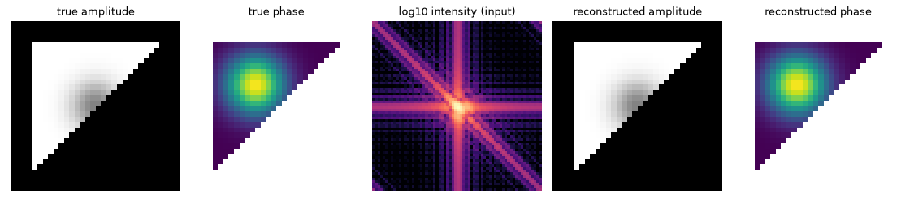

# QoraPhaseCU: phase retrieval on CUDA, and what limits the speed and accuracy of a direct implementation

*Status: draft for physics reading. Software version described: QoraPhaseCU 0.1.0 ([pyproject.toml](../pyproject.toml), [CITATION.cff](../CITATION.cff)). Every numerical value below comes from a file in this repository, named in its section; nothing was rerun for this paper. Equations describe the implemented operators, not additional measurements.*

## Abstract

Sources: [README](../README.md), [optimization log](OPTIMIZATION.md).

QoraPhaseCU implements the projection algorithms of QoraPhase in a CPU reference backend and a CUDA backend for coherent diffraction imaging. The question is how much execution time can be removed without changing the reconstruction problem, and where reduced precision changes the recovered object. On the recorded RTX 5070 measurements, the fused, graph-replayed variant with on-device error reduction reduces a single-start HIO iteration on a $256^2$ array from 0.135 ms (naive) to 0.011 ms. At $256^3$, where memory traffic dominates, cuFFT callbacks reduce the full-precision iteration from 4.115 to 3.251 ms. Batching helps small transforms but can evict larger working sets from cache and make them slower. A mixed-precision recipe, with exploratory HIO in reduced precision and final ER in full precision, takes 1.49 s against 2.08 s for the full-precision graph implementation for one start on the recorded $256^3$ known-support example. Synthetic recovery reaches float-level Fourier errors, but a separable object demonstrates that this need not imply the same object accuracy. The repository establishes implementation and performance results on synthetic problems; reconstruction accuracy on measured diffraction data and comparison with JAX on a GPU were not measured.

## 1 Background and question

Sources: [README](../README.md), [architecture](ARCHITECTURE.md). The dimensionalities and implementation descriptions here come from those files; no experimental scales are assigned.

A coherent diffraction measurement records intensity rather than the complex far-field wave. In the model used here,

$$I(\mathbf q)=|\mathcal F\rho(\mathbf q)|^2,$$

where $\rho$ is a complex object and $\mathcal F$ is a unitary discrete Fourier transform. Reconstruction alternates a measured Fourier-magnitude constraint with a real-space support constraint. It can recover amplitude and phase, subject to ambiguities and the information content of the data. Uniqueness depends on adequate diffraction sampling and oversampling relative to the object support, as well as the object and available constraints; these conditions alone do not guarantee it. The implementation accepts centered diffraction arrays in two or three dimensions. It does not introduce a different scattering model.

QoraPhaseCU asks an implementation question: can the same ER, HIO, RAAR, shrinkwrap and detwinning operations be executed efficiently with cuFFT and explicit CUDA kernels? The optimization study retains alternative implementations so that launch overhead, memory traffic, batching and precision can be compared. A separate accuracy question is whether an implementation that fits the diffraction magnitude also recovers the intended object. These questions must be kept distinct: faster iterations are useful only with an adequate support, recipe and accuracy criterion.

## 2 Method

### 2.1 Constraints, updates and default recipe

Sources: [architecture](ARCHITECTURE.md), [README](../README.md), [shared update formulas](../src/core/pointwise.hpp), [recipe implementation](../src/core/recipe.cpp), [recipe parameters](../include/qoraphasecu/recipe.hpp). All coefficients, thresholds and iteration counts in this subsection are taken from these files.

The target amplitude is $A=\sqrt{\max(I,0)}$. Let $V$ denote valid detector pixels and $S$ the support. A masked pixel is unusable and remains unconstrained; it is not assigned zero amplitude. Writing $z=\mathcal F x$, the modulus projection replaces its magnitude by $A$ on valid pixels and retains the computed wave on masked pixels:

$$P_Mx=\mathcal F^{-1}\widetilde z,\qquad
\widetilde z_{\mathbf q}=\begin{cases}
A_{\mathbf q}\exp(i\arg z_{\mathbf q}),&\mathbf q\in V,\\
z_{\mathbf q},&\mathbf q\notin V.
\end{cases}$$

This expression states the phase-preserving projection away from zero magnitude; the numerical implementation regularizes the magnitude division. The support projection is $P_Sx=\chi_Sx$. With $p_n=P_Mx_n$, all implemented updates retain $p_n$ inside $S$. Outside $S$ they use

$$x_{n+1}=a x_n+b p_n,\qquad
(a,b)=\begin{cases}
(0,0),&\mathrm{ER},\\
(1,-\beta),&\mathrm{HIO},\\
(\beta,1-2\beta),&\mathrm{RAAR}.
\end{cases}$$

Equivalently, RAAR uses $\frac{\beta}{2}(R_SR_M+\mathrm{Id})x+(1-\beta)P_Mx$, with $R=2P-\mathrm{Id}$. The default feedback coefficient is $\beta=0.9$. The default recipe is recorded as 720 iterations:

$$\mathrm{RAAR}(50)\to\mathrm{detwin}[\mathrm{HIO}(20)]\to\mathrm{RAAR}(50)
\to 8\times[\mathrm{RAAR}(50)+\mathrm{Shrinkwrap}]\to\mathrm{ER}(200).$$

Detwinning temporarily cuts the support at its center of mass along an axis, runs the enclosed stage, then restores the support. It does not remove the physical twin ambiguity from the data.

Without an input support, initialization thresholds the autocorrelation magnitude at 0.1 of its maximum. Default shrinkwrap replaces the support by

$$S\leftarrow\{\mathbf r:(G_\sigma*|x|)(\mathbf r)>\tau\max(G_\sigma*|x|)\},$$

with $\sigma=1.0$ pixel and $\tau=0.3$. Its Fourier-space Gaussian is $\exp[-2(\pi\sigma f)^2]$ per axis. An alternative threshold relative to the RMS inside the current support is available, but its threshold scale is not interchangeable with the maximum-based scale. These are software defaults, not experimentally validated universal choices.

### 2.2 Errors and comparison conventions

Sources: [architecture](ARCHITECTURE.md), [README](../README.md), [alignment implementation](../src/core/metrics.cpp), [CPU projection implementation](../src/cpu/kernels.cpp), [Python result API](../python/qoraphasecu/api.py).

The Fourier error is

$$E_F(x)=\left[\frac{\sum_{\mathbf q\in V}(|\mathcal F x|_{\mathbf q}-A_{\mathbf q})^2}
{\sum_{\mathbf q\in V}A_{\mathbf q}^2}\right]^{1/2}.$$

The history is obtained from the forward transform used for the modulus projection. It therefore describes the iterate entering that projection, rather than a separate forward evaluation of the object after its subsequent update. The best run is selected by the final recorded Fourier error.

Relative object error uses the norm of the difference divided by the reference norm after alignment. `aligned_error` considers the object and its conjugate inversion $x^*(-\mathbf r)$, finds a whole-pixel translation by cross-correlation and fits a global phase. It does not perform subpixel registration, fit an amplitude scale or remove a linear phase ramp. Thus an object error is meaningful only with its registration convention stated. No phase-only RMSE or strain accuracy measurement is reported here.

The CPU and CUDA backends share update formulas and a counter-based random-phase generator. QoraPhase uses a different random generator, so equal seeds across libraries do not specify equal starting objects. Short-run numerical agreement and eventual synthetic recovery are separate checks; long nonlinear trajectories can diverge through rounding.

### 2.3 CUDA variants and timing

Sources: [architecture](ARCHITECTURE.md), [optimization log](OPTIMIZATION.md), [README](../README.md), [comparison example](../examples/qoraphase_gpu.py).

Public arrays are center-origin. Internally, arrays remain in FFT order, avoiding repeated shifts during the iteration. The naive variant launches separate operations and reduces errors on the host. The fused variant combines modulus replacement with error accumulation, and combines support projection with the update. The graph variant reduces errors on the device and replays captured iterations. The batched variant shares a cuFFT plan among starts. The callback variant places modulus replacement and object updates in cuFFT LTO store callbacks.

The half variant stores the object and wave and computes transforms in fp16, with element-wise arithmetic in fp32. The mixed variant keeps the object in fp32, uses fp16 transforms for HIO and RAAR, and runs ER in fp32; shrinkwrap also uses the fp32 object. The fp16 transform paths require power-of-two extents.

The optimization log records an RTX 5070 with 48 MiB L2 and peak DRAM bandwidth 672 GB/s, a Ryzen 5 7500F, Windows 11, CUDA 13.4 and cuFFT 12.4. Its main HIO timings use 200 iterations after an equal-length warm-up, random data and a central box support. Plans and graphs already exist. Nsight Compute measurements are separately identified: they use application replay and base-clock control, so their kernel durations must not be substituted for wall-clock timings.

The end-to-end QoraPhase example uses the default recipe, 4 starts and known support, reporting the best of 3 timed calls after warm-up. The separate HIO comparison subtracts timings for different iteration counts to remove setup and reports the best of five differences. Neither protocol supplies a JAX GPU timing.

## 3 Results

### 3.1 Synthetic reconstruction and library agreement

Sources: [README](../README.md), [figure script](../examples/readme_figure.py), existing [reconstruction figure](reconstruction.png).

On the noiseless $64\times64$ triangular example, using the default recipe (720 iterations), with support initialized from the autocorrelation and then updated by shrinkwrap, and the best of 8 CUDA starts, the README records Fourier error $2.5\times10^{-7}$ and aligned relative object error $7.2\times10^{-7}$. The figure script defines an amplitude depression and a phase bump in the object. This is a synthetic recovery demonstration, not a measured diffraction experiment.

*Existing repository figure: true amplitude and phase, input log-intensity, and reconstructed amplitude and phase. Numerical scores are those recorded in the README; the figure was not regenerated.*

The recorded default-recipe comparison with known support is:

| Array | QoraPhase JAX CPU (s) | QoraPhaseCU CUDA (s) | Recorded speed-up | Fourier error JAX / CUDA | Aligned CUDA–JAX object error |
|---|---:|---:|---:|---:|---:|
| $256^2$ | 0.58 | 0.020 | 29x | 1.6e-7 / 2.4e-7 | 6.0e-7 |
| $128^3$ | 79.90 | 0.937 | 85x | 2.1e-7 / 4.5e-7 | 4.9e-7 |

These speed-ups compare different hardware backends on the same machine. They do not establish an advantage over JAX on a GPU. Best-of-start agreement on these examples does not establish statistical equivalence of reconstruction ensembles.

### 3.2 Launch overhead and large-array traffic

Source: [optimization log](OPTIMIZATION.md), single-start wall-clock results. Units are ms per HIO iteration; rows are copied from the same table.

| Array | naive | fused | graph | half | callback |
|---|---:|---:|---:|---:|---:|
| $256^2$ | 0.135 | 0.102 | 0.011 | 0.010 | 0.019 |
| $1024^2$ | 0.194 | 0.139 | 0.059 | 0.111 | 0.070 |
| $2048^2$ | 0.742 | 0.527 | 0.452 | 0.448 | 0.519 |
| $128^3$ | 0.287 | 0.191 | 0.113 | 0.084 | 0.143 |
| $256^3$ | 5.581 | 4.184 | 4.115 | 2.299 | 3.251 |

At $256^2$, graph replay removes much of the host synchronization and launch cost. At $256^3$, fusion matters more than graph replay. Profiling there records 43.7 element-wise DRAM bytes per element against a model of 45, with 567 GB/s throughput, 89% of peak. The FFT pair moves 91.2 bytes per element, not the simple model's 32, because the transforms require multiple passes. This measured accounting supersedes the simple traffic model as an explanation of the bottleneck.

At $1024^2$, graph profiling records only 14.9 DRAM bytes per element for the whole iteration, with 91% L2 hits. Model bytes divided by elapsed time are therefore not measured DRAM bandwidth. For callbacks at $2048^2$, the profiler attributes the loss to additional requests and cache effects; the recorded counters rule out scattered support loads as the explanation.

Callback setup was also measured: constructing the first solver of each size in the process took 249–542 ms for callback versus 2–134 ms for graph. The log records variability across runs; at $256^3$, the setup cost was paid back after 130–250 iterations.

### 3.3 Batching is conditional on cache capacity

Source: [optimization log](OPTIMIZATION.md). Eight starts; wall-clock ms per iteration per start.

| Array | graph, looped starts | batched, all 8 | batched, 2 per plan |
|---|---:|---:|---:|
| $256^2$ | 0.010 | 0.004 | 0.007 |
| $1024^2$ | 0.062 | 0.191 | 0.056 |
| $128^3$ | 0.119 | 0.270 | 0.190 |
| $256^3$ | 4.109 | 4.164 | 4.167 |

At $1024^2$, profiling gives 14.2 DRAM bytes per element per start for looped execution and 97.8 for a batch of 8; the L2 hit rate changes from 90% to 43%. The log interprets the slowdown as cache eviction. Batching is therefore a workload-dependent setting, even though the batched variant is the default and its default batch includes all starts—the configuration that is about three times slower at $1024^2$ here.

### 3.4 Precision, speed and object ambiguity

Source: [optimization log](OPTIMIZATION.md), mixed-precision section and its later non-separable-object checks. These later checks qualify the earlier generic interpretation of the reduced-precision object error.

For one start on a $256^3$ array containing a 96-voxel triangle with its known support, the second recipe run on the same solver takes:

| Recipe | graph | half | mixed |
|---|---:|---:|---:|
| HIO 400 + ER 100 | 2.08 s | 1.16 s | 1.49 s |
| default recipe | 3.09 s | 1.78 s | 2.33 s |

Separate accuracy measurements, best of 8 starts with known support after HIO 400 + ER 100, give:

| Object | Variant | Fourier error | Relative object error |
|---|---|---:|---:|
| $256^2$ | graph | 2.3e-7 | 1.9e-7 |
| $256^2$ | half | 1.3e-3 | 1.3e-3 |
| $256^2$ | mixed | 2.2e-7 | 1.9e-7 |
| $64^3$ separable prism, later check | graph | 2.7e-7 | 4.5e-6 |
| $64^3$ separable prism, later check | mixed | 3.3e-7 | 2.4e-4 |
| $64^3$ corner-cut prism with phase bump | graph | 3.1e-7 | 2.8e-7 |
| $64^3$ corner-cut prism with phase bump | mixed | 3.0e-7 | 3.0e-7 |

The timing and accuracy arrays are different; the timing table is not an accuracy measurement at that size. Pure half precision has a Fourier-error floor near $10^{-3}$ in the recorded tests. Mixed precision can remove that floor, but the separable prism still differs from the truth. It has the form $f(x,y)g(z)$, so its intensity factorizes. The log identifies nearly flat directions in the magnitude constraint associated with the axial factor. Dividing out the best axial factor leaves relative error $1.9\times10^{-7}$ for both graph and mixed results. Breaking separability with the corner cut and phase bump restores comparable object accuracy. This supports an object-conditioning explanation for that example; it does not establish accuracy for arbitrary objects or noisy measurements.

## 4 Discussion

Sources: [optimization log](OPTIMIZATION.md), [README](../README.md), [architecture](ARCHITECTURE.md). No new numerical estimates are introduced here.

The contribution is a documented execution study of established projection operations. Small transforms benefit from avoiding host round trips and replaying CUDA graphs. Larger transforms benefit from reducing memory traffic, but the relevant traffic depends on cuFFT's passes and the cache, not just on a count of array reads and writes. Callback fusion helps only when the traffic saved outweighs the extra transform and cache costs. Batching and reduced-precision transforms consequently cannot be ranked without the array shape and working-set size.

The precision study also has a physical interpretation: data fit and object recovery are separate statements. A small Fourier residual measures satisfaction of the magnitude constraint, not uniqueness or sensitivity of the inverse problem. In the separable example, full-precision finishing cannot force agreement along a direction that the data constrain only weakly. The later non-separable check prevents this observation from being generalized into a claim that mixed precision necessarily damages volumetric recovery.

The QoraPhase comparisons demonstrate practical acceleration relative to its recorded CPU execution. They do not isolate a software-only advantage independent of hardware. Likewise, synthetic examples with known support cannot establish the reliability of support estimation on experimental data.

## 5 Limitations and open questions

Sources: [README](../README.md), [optimization log](OPTIMIZATION.md), [architecture](ARCHITECTURE.md), [alignment implementation](../src/core/metrics.cpp). No new numerical estimates are introduced here.

- **Experimental validation was not measured.** The repository records synthetic examples and computational benchmarks, not measured-data reconstruction accuracy, spatial resolution, displacement accuracy or strain accuracy. No physical pixel size or photon dose is assigned to the synthetic examples summarized here.
- **Noise robustness was not measured in the reported accuracy tables.** Agreement with noiseless synthetic intensities does not establish a noise tolerance or an acceptable reduced-precision floor for an experiment.
- **Hardware scope is limited.** The optimization measurements describe the recorded GPU and software stack. A JAX GPU comparison was not measured. Batch sizes that work well on this cache need not transfer to another device.
- **Timing protocols differ.** Warmed iteration times, reused-solver recipe times, end-to-end calls and profiler kernel sums answer different questions. The log reports variability but not confidence intervals or a full distribution of timings. Its initial benchmark description is supplemented by later sections with their own protocols.
- **Precision comparisons are example-dependent.** The separable-object checks support a conditioning explanation, but do not prove uniqueness or mixed-precision safety for general objects. No broad phase-accuracy survey is recorded.
- **Registration is limited.** Whole-pixel alignment can leave fractional shifts in object scores. The implementation does not supply subpixel alignment or ensemble averaging; QoraPhase interoperation through `Ensemble.to_qoraphase()` is the existing route for ensemble analysis.
- **The forward model is restricted.** The propagator is the unitary FFT. There is no positivity or reality constraint and no partial-coherence model. An incorrect forward model is not repaired by faster projection iterations.
- **Profiling has unresolved detail.** Callback instructions were not separated from cuFFT instructions within the same kernels. Per-kernel counters constrain the explanation but do not supply that finer attribution.

## 6 Next steps

Sources for the gaps motivating these proposals: [README](../README.md), [optimization log](OPTIMIZATION.md), [architecture](ARCHITECTURE.md). These are proposed measurements, not completed work; no numerical targets are assigned.

- Compare QoraPhase and QoraPhaseCU on the same GPU platform with matched recipes, inputs and timing boundaries.
- Validate reconstruction and support estimation on measured diffraction data before claiming experimental accuracy.
- Extend accuracy comparisons to non-separable complex objects and realistic noise, separating Fourier fit, amplitude error and phase error with a stated registration convention.
- Measure precision and batch choices across devices and shapes, including setup cost on other devices where it matters to practical use.
- Resolve callback instruction costs if further callback optimization is pursued; preserve the distinction between modeled traffic and measured DRAM traffic.

## References

The repository sources below supply the implementation descriptions, measurements and figure. No external literature metadata was verified or imported.

- [README](../README.md): scope, reconstruction figure scores, QoraPhase comparison and exclusions.
- [Optimization log](OPTIMIZATION.md): benchmark protocols, wall-clock tables, measured profiling, precision tests and corrected interpretations.
- [Architecture](ARCHITECTURE.md): mapping of algorithms, array conventions and backend implementation.
- [Package metadata](../pyproject.toml) and [software citation metadata](../CITATION.cff): software version.
- [Shared pointwise formulas](../src/core/pointwise.hpp), [recipe implementation](../src/core/recipe.cpp) and [recipe parameters](../include/qoraphasecu/recipe.hpp): update equations and defaults.
- [Alignment implementation](../src/core/metrics.cpp): object-error definition and registration limits.
- [CPU projection implementation](../src/cpu/kernels.cpp) and [Python result API](../python/qoraphasecu/api.py): numerical modulus projection and final-error selection.
- [Reconstruction figure script](../examples/readme_figure.py) and [existing figure](reconstruction.png): synthetic object and display provenance.
- [QoraPhase comparison example](../examples/qoraphase_gpu.py): end-to-end comparison protocol.

