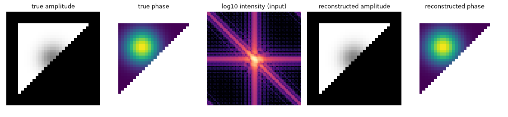

# QoraPhaseCU

QoraPhaseCU recovers a complex object from a measured 2D or 3D coherent diffraction intensity
with the algorithms of [QoraPhase](https://github.com/NaNIsaac/QoraPhase) (ER, HIO, RAAR,
shrinkwrap, detwinning, many random starts), written in C++20 with a CPU reference backend and a
CUDA backend behind one API. The Python package takes and returns numpy arrays and is shaped like
`qoraphase.reconstruct`, so a QoraPhase recipe runs here unchanged and the results go back into
QoraPhase for alignment, averaging and diagnostics, which QoraPhaseCU does not do itself.

It exists for speed on an NVIDIA GPU where JAX has none (JAX ships CUDA wheels for Linux only),
and as an optimization study: every step from a naive port to batched, graph-launched,
fp16-storage kernels and cuFFT callbacks stays a selectable variant, measured in the
[optimization log](OPTIMIZATION.md).



## Requirements

- CMake 3.28 or later and Ninja (the CMake presets use it).
- A C++20 compiler: MSVC or gcc.
- For the CUDA backend, the CUDA Toolkit 12.8 or later. The GPU architecture defaults to the
  one in the build machine (`CMAKE_CUDA_ARCHITECTURES=native`).
- For the Python package, Python 3.12 or later and numpy 2.

## Install

QoraPhaseCU is not on PyPI. The Python package is built from a clone:

```sh
git clone https://github.com/NaNIsaac/QoraPhaseCU
cd QoraPhaseCU
uv venv
uv pip install .                                          # CPU only
uv pip install . -C cmake.define.QORAPHASECU_CUDA=ON      # with the CUDA backend
```

`pip install .` works as well. The CUDA build needs the CUDA Toolkit and the compiler on the path
of the shell that runs it; on Windows, that is a shell where `vcvars64.bat` has run and `nvcc` is
found.

On Windows, scikit-build-core configures with the Visual Studio generator unless told otherwise,
and that generator finds CUDA only through the toolkit's Visual Studio integration. A toolkit
installed without it (from conda-forge, for example) fails there with `No CUDA toolset found`.
Building with Ninja avoids this:

```bat
set CMAKE_GENERATOR=Ninja
uv pip install . -C cmake.define.QORAPHASECU_CUDA=ON
```

At import, `qoraphasecu` adds `%CUDA_PATH%\bin` to the DLL search path, so cuFFT is found when
`CUDA_PATH` is set.

`.github/workflows/wheels.yml` builds CPU-only wheels (Linux x86_64, Windows AMD64, macOS arm64)
and is run by hand; no release has been published yet. For the C++ library alone, see the
[README's Quick start](../README.md#quick-start).

## First run

This needs no data file: it builds a small object, computes the intensity a detector would
record, and reconstructs from that intensity alone, without being given a support.

```python
import numpy as np
import qoraphasecu as qpc

# A 64x64 array holding a triangular object with a phase bump
n, m = 64, 24
inside = np.indices((m, m)).sum(0) < m
y, x = np.indices((m, m)) - (m - 1) / 2
block = inside * np.exp(1j * 1.2 * np.exp(-((x + 4) ** 2 + (y + 4) ** 2) / 30))
obj = np.zeros((n, n), np.complex64)
obj[n // 2 - m // 2 : n // 2 + m // 2, n // 2 - m // 2 : n // 2 + m // 2] = block

# Its far-field intensity, centred: this is what a detector records
intensity = np.abs(np.fft.fftshift(np.fft.fft2(np.fft.ifftshift(obj), norm="ortho"))) ** 2

print(f"CUDA device: {qpc.cuda_available()}")
ensemble = qpc.reconstruct(intensity, starts=8, seed=0)
best = ensemble.best
print(f"Fourier error {best.error:.1e} after {best.errors.size} iterations")
print(f"error against the true object {qpc.aligned_error(best.object, obj):.1e}")
```

The output from a CUDA build of this commit (Windows 11, Python 3.13, CUDA 13.4, RTX 5070):

```
CUDA device: True
Fourier error 2.5e-07 after 720 iterations
error against the true object 1.2e-06
```

The same run with `backend="cpu"` gave a Fourier error of 1.4e-07 and 3.0e-07 against the true
object. Both backends draw the same random starts from the same seed, but pocketfft and cuFFT
round differently and over hundreds of iterations the runs drift to different, equally valid
solutions ([Architecture](ARCHITECTURE.md#cpu-and-cuda-agree) explains this).

`backend="auto"`, the default, runs on CUDA when the build has the CUDA backend and a device is
present, and on the CPU reference otherwise; pass `backend="cpu"` or `backend="cuda"` to choose.
`qpc.aligned_error` removes the global phase, the shift (to whole pixels) and the conjugate flip
before comparing, because a reconstruction is determined only up to those. With your own data,
replace the synthetic `intensity` with your array and read the
[array conventions](../README.md#array-conventions) first: the array is center-origin, it is an
intensity and not an amplitude, and `mask=True` marks an unusable pixel.

## Where to go next

The README is the full user guide:

- [Composing a reconstruction](../README.md#composing-a-reconstruction): recipes, `repeat`, the default recipe, shrinkwrap settings.
- [With QoraPhase](../README.md#with-qoraphase): which QoraPhase stages convert, `to_qoraphase`, and a timing against QoraPhase on the same machine.
- [CUDA variants](../README.md#cuda-variants): what each `variant=` adds and its time per iteration.
- [What this does not do](../README.md#what-this-does-not-do) and [Development](../README.md#development) (C++ tests, Python tests, the benchmark).

On this site:

- [Architecture](ARCHITECTURE.md): the source layout, how it maps onto QoraPhase, and how the CPU and CUDA backends are kept in agreement.
- [Optimization log](OPTIMIZATION.md): each CUDA step with its measured DRAM traffic, the multi-start and fp16 accuracy tables, and what was not done.
- The Python API page lists the public functions and classes of the `qoraphasecu` package with their docstrings.
